# C. Architecture

## C1. Decisions and trade-offs

| Decision            | Choice                                                                                                     | Why / trade-off                                                                                                                                                                                                                                                                                            |
| ------------------- | ---------------------------------------------------------------------------------------------------------- | ---------------------------------------------------------------------------------------------------------------------------------------------------------------------------------------------------------------------------------------------------------------------------------------------------------- |
| Client              | **React 18 + TypeScript + Vite PWA**, Capacitor shells for Android/iOS                                     | Flutter was suggested, but no Flutter SDK exists in the authoring environment, so it could not be compiled or tested. The web client is verified in real Chromium (RTL, a11y). Trade-off: WebView shells are less native than Flutter. The API is client-agnostic, so a Flutter client can be added later. |
| Backend             | **Node 22 + Fastify 5 + TypeScript**, `pg`, `zod`                                                          | Small, typed, fully testable offline. Replaces Supabase Edge Functions; no vendor lock-in.                                                                                                                                                                                                                 |
| System of record    | **PostgreSQL 16**, plain SQL migrations (`db/migrations`)                                                  | Money in integer fils, constraints, triggers, RLS. Portable to any Postgres host.                                                                                                                                                                                                                          |
| Authorization       | **RLS + column grants + triggers** in the database, plus explicit checks in privileged server workflows    | Hidden UI is never the control. A compromised/buggy API route using the app role still cannot cross tenants.                                                                                                                                                                                               |
| Auth                | Phone OTP → HMAC-signed bearer token (30 d); role read from the DB on each request                         | No passwords to leak; provider-replaceable (`OtpProvider`). Trade-off: SIM-swap risk; token in `localStorage` (see `SECURITY.md`).                                                                                                                                                                         |
| Realtime            | Server-Sent Events with a 60-second ticket (the long-lived token never appears in a URL)                   | Simple, proxy-friendly. Single-instance bus; use `LISTEN/NOTIFY` or Redis to scale out.                                                                                                                                                                                                                    |
| Basket intelligence | **Deterministic rules engine is the source of truth**; AI is an optional parser helper, schema-validated   | Reproducible, explainable, testable; works with no AI key.                                                                                                                                                                                                                                                 |
| Money               | Integer fils + `currency` columns; `CHECK (total = subtotal − discount + delivery − loyalty)`              | No float errors; DB refuses inconsistent orders.                                                                                                                                                                                                                                                           |
| Order writes        | Through the **service role** after explicit authorization; DB triggers still enforce transitions + history | Orders touch stock, payments, points and notifications in one transaction. Customers/merchants have **no** UPDATE grant on `orders`.                                                                                                                                                                       |
| Baskets             | Client holds `{productId, qty}` only; **server reprices** on every edit and at checkout                    | Never trusts client totals. Generation facts are stored for analytics/audit.                                                                                                                                                                                                                               |
| Package logic       | Rows in `packages.entitlements` (jsonb), read by enforcement points                                        | Admin-configurable with no code change (tested by changing the row and observing behaviour).                                                                                                                                                                                                               |

## C2. Module boundaries

```
server/src
  domain/           PURE (no I/O): pricing.ts (delivery, totals, budget status), basketEngine.ts (filters, ranking, fitting, facts),
                    nlp.ts (EN/AR parser), text.ts (Arabic normalisation), types.ts
  providers/        interfaces + adapters: OtpProvider, PaymentProvider, AiProvider, TranscriptionProvider, StorageProvider, GeoProvider, EventBus
  services/         orders.ts (place, transitions, substitutions, disputes, webhooks), loyalty.ts, jobs.ts, loaders.ts, basketView.ts, common.ts
  http/             app.ts (Fastify, CORS, error mapping, auth hook), security.ts (tokens, signed media, rate limiter, phone), context.ts, routes/*
  db.ts             two pools (app = RLS, service = BYPASSRLS) and per-transaction identity
  migrate.ts        idempotent SQL migrator + role creation from env passwords
  seed/             bilingual catalog, stores, packages, rules, accounts, delivered sample order
web/src
  i18n/             typed EN/AR dictionaries, formatters, Arabic number agreement
  state/            auth (token, SSE), app (config, areas, persisted basket draft, server repricing)
  components/       ui kit, basket editor, budget bar, alternatives, why-this-basket, layout, area picker
  pages/{customer,merchant,admin}
```

Dependency direction: `routes → services → domain`; `domain` never imports I/O. Providers are injected into `buildApp(opts)` so tests replace them (e.g. `FailingAi`).

## C3. Data model

Money columns end in `_minor` (fils). Timestamps are `timestamptz`. IDs are UUID (orders also have a human `order_no`). Enumerations are `text` + `CHECK`.

```mermaid
erDiagram
  users ||--o{ consents : has
  users ||--o{ addresses : has
  areas ||--o{ addresses : in
  users ||--o{ business_members : "member of"
  businesses ||--o{ business_members : has
  businesses }o--|| packages : "plan (entitlements jsonb)"
  businesses ||--o{ subscriptions : has
  businesses ||--o{ stores : owns
  stores ||--o{ store_areas : serves
  areas ||--o{ store_areas : covered
  stores ||--o{ products : lists
  categories ||--o{ products : classifies
  categories ||--|| basket_rules : "quantity rule"
  products ||--o{ product_alternatives : "mapped alternatives"
  stores ||--o{ ready_baskets : offers
  ready_baskets ||--o{ ready_basket_items : contains
  users ||--o{ basket_generations : "requests (nullable for guests)"
  users ||--o{ saved_items : saves
  users ||--o{ saved_baskets : saves
  users ||--o{ conversations : "customer side"
  stores ||--o{ conversations : "business side"
  conversations ||--o{ messages : has
  conversations ||--o{ attachments : has
  conversations ||--o{ conversation_reads : "read markers"
  attachments ||--o{ transcriptions : "consented transcripts"
  users ||--o{ orders : places
  stores ||--o{ orders : fulfils
  orders ||--o{ order_items : has
  orders ||--o{ order_status_history : "append-only"
  orders ||--o{ substitution_requests : has
  orders ||--o{ payments : has
  payments ||--o{ payment_events : "webhook idempotency"
  orders ||--o{ refunds : has
  orders ||--o{ disputes : has
  disputes ||--o{ dispute_events : history
  users ||--o{ loyalty_ledger : "append-only"
  users ||--o{ notifications : receives
  users ||--o{ reports : files
  users ||--o{ data_export_jobs : requests
```



Coverage vs. the minimum list in the brief: users/profiles ✔ (`users`, `preferences`) · roles & scoped memberships ✔ (`users.role`, `business_members.permissions`) · businesses/verification ✔ (`businesses.status`, `review_note`, licence number) · packages/entitlements/subscriptions ✔ · service areas/coverage/addresses ✔ · stores & hours ✔ · catalogs, categories, products, media (image URL), attributes (diet/allergens/origin/tier), prices, stock, offers (`compare_at_minor`) ✔ — **variants are not modelled** (one sellable unit per product in the MVP) · alternatives & substitution rules ✔ (`product_alternatives`, `substitutable`, order policy + limits) · conversations/messages/attachments/read states/commerce references ✔ · transcription jobs/consent/versions/confidence/retention ✔ (`transcriptions`: faithful + readable text, uncertain words, `retention_until`; single version per attachment/requester) · preferences/restrictions/saved/favourites ✔ · basket requests, interpreted constraints, generated baskets, decision facts ✔ (`basket_generations.constraints/result`) — **revisions are not stored** (edits are client-side; `corrected_by_user` records that an edit happened) · carts/order drafts ✔ (the basket draft is client-side; no server cart) · orders, items, history, fees, payments, refunds, delivery, substitutions ✔ · ready-basket templates ✔ · loyalty accounts (derived from ledger), append-only ledger, rules, redemptions, reversals, expiry ✔ · notifications & device tokens ✔ · reports/disputes/resolution history ✔ (a single `reports` table doubles as moderation cases) · consents, data-export jobs, deletion requests, audit logs ✔.

Indexes exist for tenant/user lookups (`orders (business_id, status, placed_at)`, `messages (conversation_id, created_at desc)`, GIN full-text on products, partial index on active products). Foreign keys everywhere; `CHECK`s encode UAE phone format, non-negative money, valid statuses, `compare_at > price`, `eta_max ≥ eta_min`.

## C4. Permission matrix and RLS strategy

Three database roles: `yalasala_owner` (migrations), `yalasala_app` (**subject to RLS**, least-privilege grants, used for all user-scoped reads/writes), `yalasala_service` (`BYPASSRLS`, server-only; used by auth, order placement/transitions, loyalty posting, audit, jobs). Each request runs in a transaction with `set_config('app.user_id', …, true)`; `app_role()` reads the role from `users` (never from the client) via a `SECURITY DEFINER` function.

| Resource                                                   | Anonymous      | Customer (own)                                    | Merchant owner (own business)                                               | Staff (permission-scoped) | Support                               | Admin                                           |
| ---------------------------------------------------------- | -------------- | ------------------------------------------------- | --------------------------------------------------------------------------- | ------------------------- | ------------------------------------- | ----------------------------------------------- |
| Areas, categories, rules, active packages, loyalty rules   | read           | read                                              | read                                                                        | read                      | read                                  | read/write (areas, categories, packages, rules) |
| Approved businesses/stores, active products, ready baskets | read           | read                                              | read                                                                        | read                      | read all                              | read/write products                             |
| Own store profile, service areas                           | —              | —                                                 | read/write (business writable)                                              | —                         | read                                  | write (areas, audited)                          |
| Catalog (products, alternatives, ready baskets)            | —              | —                                                 | read/write                                                                  | `catalog`                 | read                                  | write                                           |
| Business record                                            | approved: read | —                                                 | update name/licence/contact; **cannot** change status/package/review fields | read                      | read                                  | review via audited service call                 |
| Orders / items / history / substitutions                   | —              | read own                                          | read (all of its orders)                                                    | `orders`                  | read all                              | read all; cancel via audited call               |
| Order **writes**                                           | —              | cancel/answer substitutions through API (checked) | transitions & unavailable-item reports through API (checked)                | same, with `orders`       | cancel (audited)                      | any valid transition (audited)                  |
| Conversations / messages / attachments                     | —              | participant                                       | participant                                                                 | `conversations`           | only while a report on it is **open** | same as support                                 |
| Transcripts                                                | —              | requester only                                    | —                                                                           | —                         | —                                     | —                                               |
| Loyalty ledger                                             | —              | read own                                          | —                                                                           | —                         | read                                  | read; adjustments via audited call              |
| Reports / disputes                                         | —              | create/read own                                   | read disputes on own orders                                                 | `orders`                  | read/resolve                          | read/resolve                                    |
| Audit log                                                  | —              | —                                                 | —                                                                           | —                         | —                                     | read (append-only for everyone)                 |
| Users                                                      | —              | read/update own safe columns                      | —                                                                           | —                         | read                                  | restrict/activate (audited)                     |

Highlights: column-level `GRANT UPDATE` (e.g. `users` may only change `name, email, locale, marketing_opt_in, preferences`; `businesses` may not change `package_id`/review fields); **append-only** triggers on `loyalty_ledger`, `audit_logs`, `order_status_history` (even the service role cannot update/delete); `orders_guard` trigger validates transitions and writes history; `business_guard` stops self-approval; `conv_guard` limits who can flip block flags. RLS is _enabled_ but not _forced_, so a host that disallows `BYPASSRLS` can run the service pool as the table owner. All of this is exercised by `server/test/rls.test.ts` directly against the database, independent of the HTTP layer. If you prefer Supabase: the same SQL runs on Supabase Postgres; replace `app_uid()` with `auth.uid()` and the login-role plumbing with its JWT claims.

## C5. Basket engine and deterministic fallback

Pipeline (`server/src/domain/basketEngine.ts`, orchestrated in `routes/baskets.ts`):

1. **Parse & normalise** — `nlp.ts` (EN/AR/mixed; Arabic-Indic digits, number words, budget, scope, household, duration, diet, allergens, exclusions, area). An optional `AiProvider.enhanceParse` may _fill gaps only_; its output is schema-validated (`zod`) and any failure falls back silently to rules, flagged `fallbackUsed`.
2. **Confirm ambiguity** — `needsConfirmation` lists missing/ambiguous fields; a budget without a stated scope is always ambiguous. The server also refuses generation with a budget unless `budgetScopeConfirmed` (`BUDGET_SCOPE_REQUIRED`).
3. **Retrieve eligible products** — only stores that are approved, active and serve the area; only active, in-stock products.
4. **Hard constraints** — allergens, hard diets (halal, vegetarian, gluten-free), excluded terms, baby-safe; soft preferences (organic, high-protein, low-sugar) only rank.
5. **Score with explainable rules** — must-have > preferred brand > diet tags > tier preference > price.
6. **Assemble deterministically** — per category: `ceil(units/person/week × boost × people × days/7)` clamped to rule min/max; non-essential categories under half a pack are skipped; quantities capped by stock.
7. **Fit the budget** — greedy and ordered to protect essentials: cheaper alternatives for non-essentials → drop optionals → cheaper alternatives for essentials → reduce standard quantities → drop standard items. Delivery fee (incl. free-delivery threshold) is recomputed at every step. If essentials alone exceed the budget the result is flagged `over` with the shortfall; it is never presented as within budget.
8. **Validate server-side** — every product id/price/stock is re-read from the database on `/baskets/price` and `/orders`; client totals are ignored.
9. **Explain from facts** — the engine emits typed facts (`planned_for`, `savings_from_alternatives`, `budget_under`, …); the client renders them in the user's language. Savings are only claimed when swaps happened; preference claims only when a chosen product carries the tag.
10. **Explicit approval** — order creation requires an authenticated customer, accepted terms, an idempotency key and (if over budget) `approveOverBudget`.

Store choice: all eligible stores are built independently; the best is chosen by complete essentials → within budget → most essentials covered → lowest total. The UI states that baskets are single-store.

## C6. Provider interfaces and the mock/live boundary

See `docs/PROVIDERS.md`. In short: each external capability is an interface in `server/src/providers/index.ts` with a labelled adapter; `/api/config` and the admin Providers page expose **modes only** (never secrets) and the UI shows a banner whenever any test/sandbox integration is active. Production start-up **refuses** `OTP_PROVIDER=mock` and default dev secrets.

## C7. Security, privacy, retention, audit

See `docs/SECURITY.md` for the threat model and the retention table. Key points: no E2E-encryption claim; signed, expiring media URLs; upload content sniffing; rate limits on OTP/messages/uploads/AI/transcription/orders; webhook HMAC + idempotency; idempotent orders, payments, refunds, loyalty entries and notifications; audit log for admin, financial, moderation and loyalty actions with mandatory reasons; privacy-aware logs (the request logger redacts the `Authorization` header and error logs omit bodies).

## C8. Repository tree

```
.
├── README.md  LICENSE  THIRD_PARTY_LICENSES.md  .env.example  docker-compose.yml  package.json  package-lock.json
├── .github/workflows/ci.yml
├── db/migrations/{001_schema.sql, 002_rls.sql}
├── scripts/{local-pg.sh, backup.sh, restore.sh, make-zip.sh, gen-placeholders.mjs, gen-ux-copy.mts, gen-licenses.mjs}
├── docs/{01-PRODUCT, 02-ARCHITECTURE, 03-OPERATIONS, 04-ACCEPTANCE, 05-ROADMAP, SECURITY, PROVIDERS, UX-COPY}.md
├── server/  (package.json, tsconfig*.json, eslint.config.js, vitest.config.ts, Dockerfile)
│   ├── src/{config,db,migrate,export,index}.ts
│   ├── src/domain/…  src/providers/…  src/services/…  src/http/…  src/seed/…
│   └── test/{global-setup, helpers, domain, rls, api.baskets, api.orders, api.messaging, api.merchant, api.admin}.ts
└── web/  (package.json, vite.config.ts, playwright.config.ts, capacitor.config.ts, Dockerfile, nginx.conf)
    ├── src/{main,App,styles}…  src/{i18n,lib,state,components,pages}/…
    ├── e2e/{customer.spec, helpers, global-setup}.ts
    ├── public/{manifest.webmanifest, icon.svg, img/…}
    └── android/  ios/   (Capacitor-generated native projects)
```
